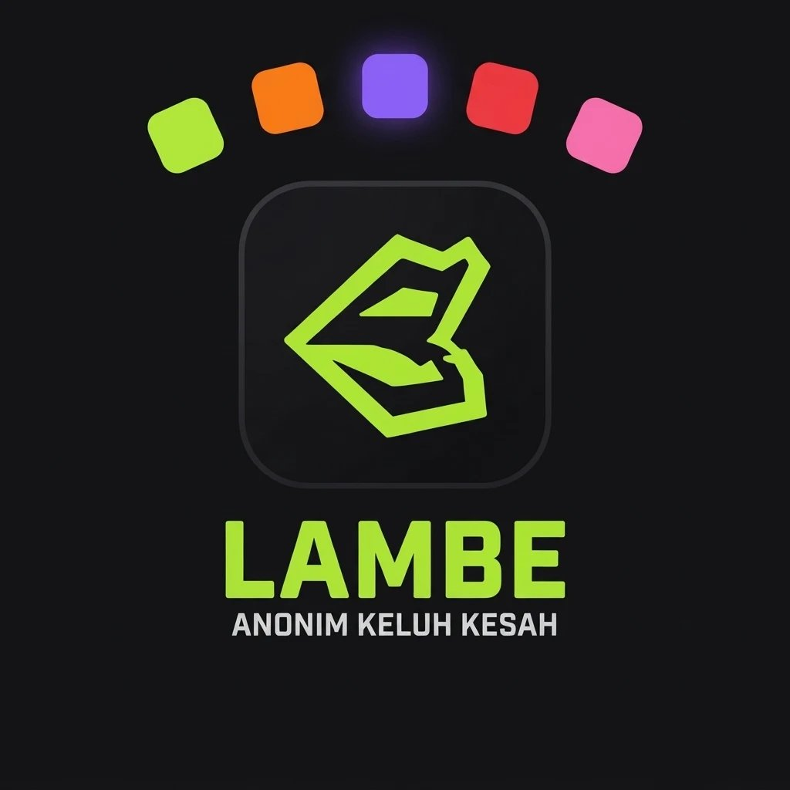

# LAMBE — Ruang Anonim Keluh Kesah & Celetukan

<p align="center">
  
</p>

<p align="center">
  <strong>Ruang Keluh Kesah & Celetukan Jujur 100% Anonim Tanpa Nama Asli, Tanpa Profil Publik</strong>
</p>

<p align="center">
  
  
  
  
  
</p>

---

## 🌟 Tentang LAMBE

**LAMBE** adalah aplikasi linimasa mikroblogging (*tweet* / keluh kesah) anonim bergaya kaca modern (*Frosted Glassmorphism*) yang dirancang khusus untuk kenyamanan melampiaskan unek-unek tanpa rasa cemas dihakimi. 

Di LAMBE:
- **100% Anonim:** Setiap pengguna memakai `@username` samaran unik. **Tidak ada halaman profil publik**, tidak ada follower/following, dan username tidak dapat diklik untuk mencari tahu identitas siapapun.
- **Linimasa & Thread Ala X / Threads:** Format kartu postingan yang rapi, garis alur balasan (*thread connector line*), tata letak galeri multi-foto proporsional tanpa *crop* paksa, serta baris aksi (*Like*, Balas/*Thread*, dan Bagikan).
- **Ganti Tema Fleksibel:** Pilihan tema modern yang tersimpan persisten:
  1. **Glass Dark** — Tema kaca buram obsidian dengan ambient glow lembut.
  2. **Midnight (OLED)** — Hitam pekat sejati `#000000`, kontras tinggi, dan hemat baterai di layar AMOLED/OLED.
  3. **Light Frosted** — Kaca buram cerah, bersih, dan sejuk.
  4. **5 Aksen Warna Ikonik LAMBE** — Acid Lime (`#C8FF2E`), Amber Signal, Electric Violet, Vermilion Red, dan Rose Pink.
- **Fitur Bagikan (Share):** Membagikan teks/ringkasan postingan beserta *deep link* (`lambeapp://`) atau tautan web menggunakan dialog native perangkat (`Share.share`) atau *clipboard fallback*.
- **Unggah Media Tanpa Batas:** Mendukung 1 hingga 4 foto langsung dari kamera atau galeri per postingan tanpa layar *crop* paksa, dengan kompresi lokal sebelum diunggah ke Cloudinary Unsigned.

---

## 🚀 Fitur Utama

1. **Tata Letak Linimasa & Thread ala X / Threads:**
   - Kartu postingan dengan avatar anonim, `@username` samaran, tanda kepemilikan (`Kamu`), dan waktu relatif.
   - Layout foto adaptif: 1 foto (rasio alami), 2 foto (2 kolom), 3 foto (1 besar + 2 bertumpuk), 4 foto (grid 2x2).
   - Tampilan alur percakapan thread dengan garis konektor vertikal yang menghubungkan postingan utama dengan balasan-balasan.
   - Tombol interaksi cepat: **Like** (animasi aksen), **Balas/Thread**, dan **Bagikan**.

2. **Sistem Multi-Tema & Palet Aksen:**
   - Pemilih tema langsung melalui modal cepat di header linimasa.
   - Persistensi otomatis melalui `@react-native-async-storage/async-storage` di mobile dan `localStorage` di web.
   - Aksen hijau limau (`#C8FF2E`) dipertahankan tajam pada mode gelap dan dikalibrasi kontras tinggi (`#4D7C0F`) pada mode terang untuk menjamin keterbacaan (WCAG AAA).

3. **Keamanan & Kompatibilitas Backend:**
   - **Supabase PostgreSQL:** Autentikasi aman, tabel `profiles`, `posts`, `likes`, dan SQL view `anon_tweets` dengan Row Level Security (RLS).
   - **Cloudinary Unsigned:** Pengunggahan base64 murni menggunakan `fetch` + `URLSearchParams` bertipe `'Content-Type': 'application/x-www-form-urlencoded'`.
   - **Bebas Kunci Rahasia:** Tidak ada `service_role` key, *private key*, atau *API secret* di dalam bundel kode klien.

---

## 📂 Struktur Proyek

```text
lambe-app/
├── assets/                       # Aset ikon, adaptive icon, dan logo LAMBE
│   ├── adaptive-icon.png
│   ├── icon.png
│   ├── lambe-logo.png
│   └── ...
├── src/
│   ├── components/               # Komponen UI
│   │   ├── GlassBackground.js    # Latar ambient glow kaca
│   │   ├── PostCard.js           # Kartu tweet & thread ala X / Threads
│   │   ├── ThemeModal.js         # Modal pemilih tema & 5 warna aksen
│   │   └── UsernameModal.js      # Modal ganti @username samaran
│   ├── config/
│   │   └── env.js                # Konfigurasi endpoint publik (Supabase & Cloudinary)
│   ├── context/
│   │   └── ThemeContext.js       # Global state tema & penyimpanan persisten
│   ├── lib/                      # Helper & integrasi API
│   │   ├── cloudinary.js         # Pengambilan foto, kompresi, & upload unsigned
│   │   ├── imageParser.js        # Parser string / array gambar postingan
│   │   ├── shareHelper.js        # Helper bagikan postingan (Share API & Web fallback)
│   │   ├── supabase.js           # Inisialisasi Supabase client
│   │   └── usernameGenerator.js  # Generator & validator nama samaran
│   ├── screens/                  # Layar aplikasi
│   │   ├── AuthScreen.js         # Masuk, Daftar, Lupa Sandi, & Google OAuth
│   │   ├── CreatePostScreen.js   # Tulis keluh kesah & lampirkan 1-4 foto
│   │   ├── FeedScreen.js         # Linimasa tweet anonim & floating dock
│   │   ├── ThreadScreen.js       # Alur thread balasan & input bar cepat
│   │   └── UsernameSetupScreen.js# Setup awal nama samaran setelah pendaftaran
│   └── theme/
│       └── themes.js             # Definisi token warna (Glass Dark, Midnight, Light Frosted)
├── App.js                        # Entry point & navigasi
├── app.json                      # Konfigurasi Expo & EAS
├── package.json                  # Dependensi proyek
└── README.md
```

---

## 🛠️ Panduan Memulai

### 1. Prasyarat
- [Node.js](https://nodejs.org/) versi 18 atau 20+
- [Git](https://git-scm.com/)
- Expo Go di HP fisik atau emulator Android/iOS

### 2. Instalasi Dependensi
```bash
git clone https://github.com/nafiszakiramdhan-web/lambe.git
cd lambe
npm install
```

### 3. Menjalankan Aplikasi
```bash
# Menjalankan Expo Dev Server
npx expo start

# Menjalankan di Android
npx expo start --android

# Menjalankan di Web
npx expo start --web
```

---

## 🔒 Kebijakan Keamanan & Privasi

1. **Tanpa Pelacakan Data Pribadi:** Identitas asli pengguna tidak pernah dibagikan atau ditampilkan di postingan manapun.
2. **Kunci Sensitif:** Semua komunikasi menggunakan *publishable anon key* Supabase dan *unsigned upload preset* Cloudinary. File lingkungan rahasia serta berkas kunci (`.env`, `*.keystore`, `*.jks`, dll) selalu dikecualikan melalui `.gitignore`.

---

## 📄 Lisensi

Proyek ini dilisensikan di bawah lisensi **MIT** — lihat berkas [LICENSE](./LICENSE) untuk detail selengkapnya.
